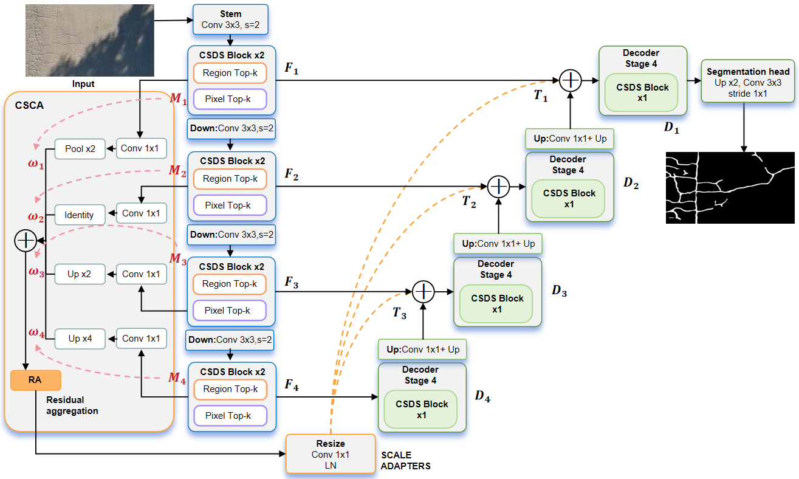
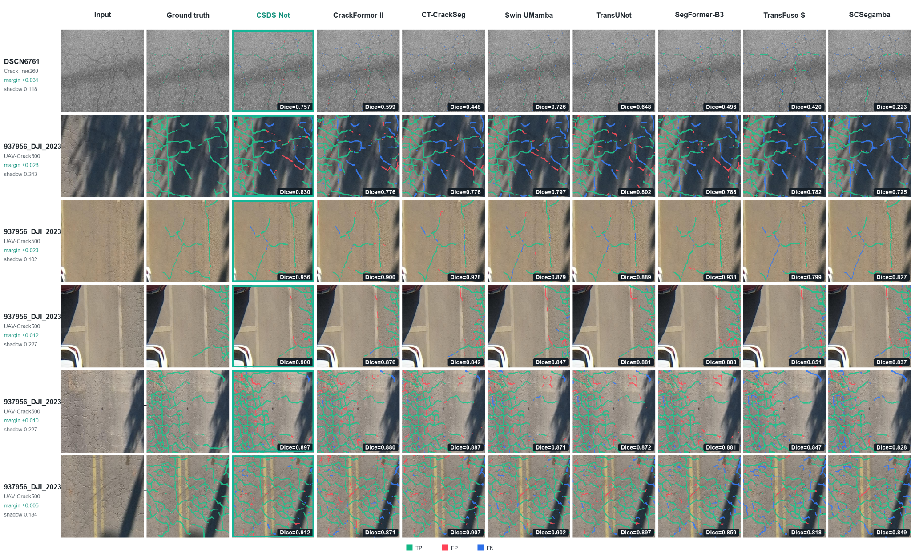

### 📖 CSDS-Net: A Structure-Guided Dual-Sparse Network for Road Crack Segmentation

[Manuscript/code mapping](docs/IMPLEMENTATION.md) · [Training protocol](docs/PROTOCOL.md) · [Archived results](results/summary.csv)

**Lihong Peng**, **Xinqi Zou** (corresponding author), and **Zhuoran Xie**<br />
School of Computer Science, Shandong Xiehe University, Jinan, China<br />
School of Electronic and Information Engineering, Yiyang Vocational and Technical College, Yiyang, China

This repository is organized around the supplied CSDS-Net manuscript. In the paper, CSDS-Net uses a four-level encoder–decoder with two CSDS Blocks per encoder level (64/128/256/512 channels), structure-guided regional and pixel sparse interaction, and crack-structure-aware context aggregation (CSCA) feeding additive decoder skips.

The public training package contains a checkpoint-compatible semantic research variant. Its verified implementation is not identical to every operation in the manuscript; the differences are listed in [Implementation](docs/IMPLEMENTATION.md). Paper-facing descriptions and reported tables in this README follow the manuscript, while runnable commands describe the included code. The manuscript has no verified public DOI or paper/weight download link in this release.

---



**Figure 1. Overall architecture of CSDS-Net.** Encoder features F1–F4 supply the decoder and CSCA; structural responses M1–M4 guide scale weights, and residual aggregation plus scale adapters provide context to additive skip connections. This is the manuscript architecture; see the implementation mapping before associating its operations with the packaged code.

#### 😶‍🌫️ Experiments

The figures and tables below are reproduced from the supplied manuscript and its LaTeX source. The PNGs are the original paper assets; no new experiment plots were generated. Tables 2, 3 and 6 use the manuscript CSV files; Tables 1, 4 and 5 are transcribed from the paper text. These are **manuscript-reported values**, not a fresh calculation from the archived runs. The source includes manually adjusted comparison entries and CSDS-Net uncertainty terms not verified from repeated CSDS-Net runs; [result provenance](docs/PAPER_REFERENCE.md#result-provenance) distinguishes these from the archived measurements.

**Figure 3. Qualitative comparison on representative pavement images.** Columns show input, ground truth, and model segmentation; green, red, and blue indicate true-positive, false-positive, and false-negative regions.



**Table 1. Training and evaluation settings for the structural ablations.**

| Item | Setting |
| --- | --- |
| Input | RGB, 256 x 256 |
| Data split | Fixed 80% / 20% training / validation; partition seed 42 |
| Replications | Training seeds 42, 123, and 3407; three runs per configuration |
| Training budget | 100 epochs per run from random initialization |
| Optimizer | AdamW; initial learning rate 0.0001; weight decay 0.0001 |
| Batch and schedule | Batch size = 8; cosine annealing; automatic mixed precision |
| Checkpoint | Selected by strict-pixel validation Dice; tolerance metrics read at the same epoch |
| Prediction threshold | 0.5 |
| CrackTree260 | Positive-class weight 8; hard-negative weight 2; standard augmentation |
| CrackSC / UAV-Crack500 | Positive-class weight 4; hard-negative weight 1; strong augmentation |
| Supervision | Final balanced loss for all six configurations; boundary-supervision coefficient 0.15 |

**Table 2. Quantitative comparison on three datasets.** PA, Pr, Re, and Dice are reported as mean ± standard deviation; IoU is a point estimate. Bold values mark the best value for each metric within a dataset, as in the manuscript.

| Method | PA ↑ | Pr ↑ | Re ↑ | IoU ↑ | Dice ↑ |
|---|---:|---:|---:|---:|---:|
| **CrackTree260** |  |  |  |  | |
| SCSegamba | 0.9917 ± 0.0003 | 0.8630 ± 0.0163 | 0.3802 ± 0.0793 | 0.3587 | 0.5252 ± 0.0800 |
| SegFormer-B3 | 0.9914 ± 0.0001 | 0.8810 ± 0.0034 | 0.6041 ± 0.0046 | 0.5586 | 0.7168 ± 0.0033 |
| TransFuse-S | 0.9902 ± 0.0004 | **0.8872 ± 0.0036** | 0.5701 ± 0.0173 | 0.5315 | 0.6940 ± 0.0117 |
| TransUNet | 0.9928 ± 0.0002 | 0.8677 ± 0.0081 | 0.7688 ± 0.0044 | 0.6882 | 0.8135 ± 0.0050 |
| Swin-UMamba | 0.9940 ± 0.0002 | 0.8721 ± 0.0030 | 0.8221 ± 0.0129 | 0.7336 | 0.8463 ± 0.0056 |
| CT-CrackSeg | 0.9919 ± 0.0004 | 0.8388 ± 0.0179 | 0.8119 ± 0.0306 | 0.7023 | 0.8249 ± 0.0192 |
| CrackFormer-II | **0.9945 ± 0.0000** | 0.8816 ± 0.0013 | 0.8131 ± 0.0168 | 0.7330 | 0.8459 ± 0.0092 |
| CSDS-Net (Ours) | 0.9932 ± 0.0002 | 0.8573 ± 0.0036 | **0.8906 ± 0.0168** | **0.7756** | **0.8736 ± 0.0092** |
| **CrackSC** |  |  |  |  | |
| SCSegamba | 0.9616 ± 0.0206 | 0.6524 ± 0.3322 | 0.6033 ± 0.0918 | 0.4589 | 0.6071 ± 0.2232 |
| SegFormer-B3 | 0.9765 ± 0.0010 | 0.8743 ± 0.0109 | 0.7378 ± 0.0182 | 0.6668 | 0.8001 ± 0.0062 |
| TransFuse-S | 0.9767 ± 0.0005 | **0.8918 ± 0.0081** | 0.6967 ± 0.0185 | 0.6422 | 0.7821 ± 0.0085 |
| TransUNet | 0.9754 ± 0.0008 | 0.8089 ± 0.0036 | 0.7335 ± 0.0130 | 0.6251 | 0.7693 ± 0.0069 |
| Swin-UMamba | **0.9794 ± 0.0003** | 0.8719 ± 0.0024 | 0.7939 ± 0.0045 | 0.7110 | 0.8311 ± 0.0033 |
| CT-CrackSeg | 0.9755 ± 0.0013 | 0.8657 ± 0.0179 | 0.7875 ± 0.0132 | 0.7016 | 0.8246 ± 0.0051 |
| CrackFormer-II | 0.9773 ± 0.0001 | 0.8531 ± 0.0080 | 0.7478 ± 0.0238 | 0.6626 | 0.7969 ± 0.0168 |
| CSDS-Net (Ours) | 0.9747 ± 0.0008 | 0.8464 ± 0.0081 | **0.8428 ± 0.0182** | **0.7310** | **0.8446 ± 0.0069** |
| **UAV-Crack500** |  |  |  |  | |
| SCSegamba | 0.9621 ± 0.0013 | 0.9295 ± 0.0061 | 0.8173 ± 0.0202 | 0.7697 | 0.8698 ± 0.0121 |
| SegFormer-B3 | 0.9604 ± 0.0004 | 0.8949 ± 0.0067 | 0.8649 ± 0.0100 | 0.7851 | 0.8796 ± 0.0019 |
| TransFuse-S | 0.9597 ± 0.0009 | **0.9383 ± 0.0165** | 0.8055 ± 0.0291 | 0.7645 | 0.8665 ± 0.0096 |
| TransUNet | 0.9651 ± 0.0006 | 0.8963 ± 0.0109 | 0.8581 ± 0.0141 | 0.7804 | 0.8767 ± 0.0026 |
| Swin-UMamba | 0.9662 ± 0.0003 | 0.8947 ± 0.0073 | 0.8705 ± 0.0077 | 0.7896 | 0.8824 ± 0.0005 |
| CT-CrackSeg | **0.9693 ± 0.0007** | 0.9193 ± 0.0039 | 0.8659 ± 0.0007 | 0.8047 | 0.8918 ± 0.0016 |
| CrackFormer-II | 0.9644 ± 0.0002 | 0.9039 ± 0.0049 | 0.8701 ± 0.0049 | 0.7964 | 0.8866 ± 0.0014 |
| CSDS-Net (Ours) | 0.9678 ± 0.0006 | 0.9149 ± 0.0067 | **0.8934 ± 0.0100** | **0.8248** | **0.9040 ± 0.0019** |

#### 📢 News

- **2026-10-29:** Local release candidate organized with portable training,
  validation, prediction, profiling, six ablation configurations and audited
  histories. This date records package preparation, not paper acceptance or a
  public GitHub release.

#### 🔧 Requirements and Installation

> - Reference training environment: Python 3.9.21
> - PyTorch 2.0.1 with CUDA 11.7; NVIDIA RTX 3090 (24 GB)
> - NumPy 1.26.4 and Pillow 11.1.0
> - THOP 0.1.1.post2209072238 for model profiling
> - Matplotlib is optional, for figure generation only

CPU operation is supported. Other PyTorch 2.x combinations have not been fully
retrained/validated here. This model requires neither torchvision nor custom
CUDA/selective-scan extensions.

#### 👽 Installation

Open the prepared `CSDS-Net` repository directory, then create an environment:

```bash
conda create -n csds-net python=3.9 -y
conda activate csds-net
# Reference CUDA 11.7 environment. Choose a wheel matching your hardware.
pip install torch==2.0.1 --index-url https://download.pytorch.org/whl/cu117
pip install -r requirements.txt
python -m unittest discover -s tests -v
```

For a CPU-only installation, replace the PyTorch install command with:

```bash
pip install torch==2.0.1 --index-url https://download.pytorch.org/whl/cpu
```

#### 🚗 Datasets

| Dataset | Images reported in manuscript | Source |
|---|---:|---|
| CrackTree260 | 260 | [DeepCrack](https://github.com/qinnzou/DeepCrack#download) |
| CrackSC | 197 | [Transformer-Crack](https://github.com/jonguo111/Transformer-Crack) |
| UAV-Crack500 | 500 patches | [UAV-CrackX source study](https://github.com/SHAN-JH/UAV-CrackX-Datasets) |

Counts in this table follow the manuscript. The packaged archived split manifests contain 260 CrackTree260 pairs (208/52), 197 CrackSC pairs (158/39), and 1,200 pairs for the UAV experiment (960/240), whereas the manuscript describes UAV-Crack500 as 500 patches. Exact equivalence to a specific 500-patch release is not established; the publicly available CrackSC files may also be partial. The code recipes use the included split manifests, fixed 80/20 train/validation splits and no independent test set. No dataset is redistributed. See [dataset preparation](docs/DATASETS.md) for the packaged data version and layout.

```bash
python prepare_data.py --data-root datasets/CrackTree260 --reference splits/CrackTree260.json
python prepare_data.py --data-root datasets/CrackSC --reference splits/CrackSC.json
python prepare_data.py --data-root datasets/UAV-Crack500 --reference splits/UAV-Crack500.json
```

#### 🎈 Training and Testing

Train each dataset separately with random initialization; no pretrained weights
are needed. Each JSON recipe defines the archived loss/augmentation settings.
The scripts check the supplied fixed split before training.

```bash
python train.py --config configs/CrackTree260.json --data-root datasets/CrackTree260
python train.py --config configs/CrackSC.json --data-root datasets/CrackSC
python train.py --config configs/UAV-Crack500.json --data-root datasets/UAV-Crack500
```

All recipes use 100 epochs, RGB 256x256, batch 8, AdamW lr/weight_decay 1e-4,
cosine annealing, AMP on CUDA, weighted BCE + soft Dice + 0.15 boundary BCE,
and strict validation Dice checkpoint selection. Metrics are recorded in
`history.csv` (strict) and `tolerance2_history.csv` (2px), alongside
`best.pt`, `last.pt`, `config.json`, `split_manifest.json`, and `profile.json`.
See [Protocol](docs/PROTOCOL.md) for full loss, augmentation and precision details.

```bash
# Resume from last.pt; keep the original epoch budget/configuration.
python train.py --config configs/CrackTree260.json --data-root datasets/CrackTree260 --resume
# Additional fixed training seeds; split_seed stays 42.
python train.py --config configs/CrackTree260.json --data-root datasets/CrackTree260 --seed 123
python train.py --config configs/CrackTree260.json --data-root datasets/CrackTree260 --seed 3407
# Example ablation; substitute the group from docs/IMPLEMENTATION.md.
python train.py --config configs/CrackTree260.json --data-root datasets/CrackTree260 --model csds_ablation_m4
```

The following commands evaluate the validation split, predict an image, and
measure model-only FP32 speed. Repeat with the corresponding dataset/checkpoint
for CrackSC and UAV. Only load trusted checkpoint files.

```bash
python evaluate.py --data-root datasets/CrackTree260 --checkpoint runs/csds_semantic/CrackTree260/csds_semantic/seed_42/best.pt --output runs/evaluation.json
python predict.py --image path/to/image.jpg --checkpoint runs/csds_semantic/CrackTree260/csds_semantic/seed_42/best.pt --output-dir runs/prediction
python profile_model.py --model csds_semantic --image-size 256 --output runs/profile.json
python tools/summarize.py --input results/per_seed.csv --output runs/recomputed_summary.csv
```

Predictions are saved at the checkpoint's input resolution. Evaluation reports
strict IoU separately from `iou_derived = Dice2/(2-Dice2)`. The latter uses
bidirectional 5x5 tolerance and is not strict pixel intersection-over-union.
Threshold remains 0.5; PA remains exact. There is no independent test result.

#### 🔥Model Performance

The paper-reported model comparison is Table 2 above; the reported GFLOPs, parameter counts and FPS are in Table 6. The manuscript reports CSDS-Net at 5.95 M parameters, 26.39 GFLOPs and 122.66 FPS. These values are reproduced as printed in the paper. The separately archived code measurements and unadjusted run summaries are available in [release profile](results/release_profile.json), [per-seed observations](results/per_seed.csv), [three-seed summary](results/summary.csv), and [raw baseline comparison](results/COMPARISON.md). SCSegamba and Swin-UMamba comparison runs use pure-PyTorch selective-scan approximations rather than the official CUDA implementations.

#### 🔗Citation

If this code is useful, please cite the associated manuscript. The entry below
does not imply journal acceptance; replace it with the final bibliographic entry
when a verified publication record becomes available.

```bibtex
@unpublished{peng2026csdsnet,
  title={CSDS-Net: A Structure-Guided Dual-Sparse Network for Road Crack Segmentation},
  author={Peng, Lihong and Zou, Xinqi and Xie, Zhuoran},
  year={2026},
  note={Manuscript submitted to Sensors}
}
```

#### 📨 Contact

For questions, contact **Xinqi Zou** at
[phoebezou1248@gmail.com](mailto:phoebezou1248@gmail.com).

#### 🌻 Acknowledgement

We acknowledge the original dataset providers and the PyTorch/THOP communities.
The README's section organization follows [MASFNet](https://github.com/PolarisFTL/MASFNet);
its code, experimental claims and assets are not copied. The manuscript credits
GLoU-MiT/U-Mix, region-to-pixel sparse selection, AFEM and MedCAGD as methodological
inspiration; direct code equivalence is not asserted.

This work was supported by the Scientific Research Startup Fund for High-Level
Talents of Shandong Xiehe University (SDXHQD2025098). See [NOTICE](NOTICE.md) for
source, dataset and licensing status. A source-code license remains to be chosen
by the rights holders before public release.
