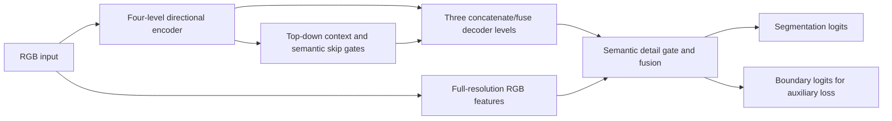

# Implementation and manuscript mapping

The README's method overview, dataset descriptions and experiment displays now
follow the supplied final manuscript. [Paper reference](PAPER_REFERENCE.md)
collects that description and the original figure/table sources. The mapping
below concerns the runnable code and must remain explicit even when the
paper-facing prose uses manuscript terminology.

This package provides the **checkpoint-compatible semantic research variant**
used by the archived experiments. It is a functional code release candidate,
not a verified implementation of every operation in manuscript Section 2.
No network has been replaced after training to make it resemble the paper.

| Component | Final manuscript | Released/trained implementation |
|---|---|---|
| Encoder width | 64, 128, 256, 512 | 48, 96, 192, 384 |
| Encoder blocks | Two independently parameterized blocks per level | One directional residual block per level |
| Structural representation | Gaussian differences and pooled channel affinities, response M and 5-direction alpha | Local/dilated and horizontal/vertical depthwise branches, dense channel/spatial gates |
| Regional interaction | Response-weighted regional Top-K routing | No regional Top-K operator |
| Pixel interaction | Directional Gaussian prior, local-neighbor retention, pixel Top-K attention | Dense multiplicative enhancement gates; no sparse Q/K/V attention |
| CSCA | All levels aligned to common H/4 grid; response-aware spatial scale weights; shared context | Top-down projections from coarser scales, averaging, semantic-gated native skip features |
| Decoder skip | Projected upsample + encoder skip + context, additive | Bilinear upsample, concatenation, 3x3 learned fusion |
| Full-resolution output | Upsample D1 and 3x3 head | Semantic-gated RGB detail branch, fusion/refinement, segmentation and boundary heads |
| Parameters / cost | 5.95 M / 26.39 GFLOPs reported | 5.954214 M / 26.388834624 THOP GFLOPs for the actual semantic model |

The parameter and computation numbers matching the manuscript do not establish
architectural equivalence. No matching Gaussian/Top-K implementation was found
in the root code, experiment snapshots, or supplied LaTeX archive. Adding a new
implementation would require explicit choices for unspecified attention
hyperparameters and new verification/training. Such an implementation must
remain separate from these existing checkpoints and results.

## Actual forward path

## Packaged modules and ablations

Historical class names are retained to load existing checkpoints. Here **A**
means directional/channel/spatial gated enhancement, **B** means top-down
semantic context, and **C** means full-resolution gated RGB detail. These are
implementation configurations, not isolated ablations of the manuscript's
Gaussian prior or hard Top-K operations.

| Group | CLI model | A | B | C |
|---|---|---:|---:|---:|
| M0 | csds_ablation_m0 | 0 | 0 | 0 |
| M1 | csds_ablation_m1 | 1 | 0 | 0 |
| M2 | csds_ablation_m2 | 1 | 1 | 0 |
| M3 | csds_ablation_m3 | 1 | 0 | 1 |
| M4 | csds_ablation_m4 | 0 | 1 | 1 |
| M5 | csds_semantic | 1 | 1 | 1 |

All preserve the original four-level topology and random initialization. M2
retains the historical auxiliary boundary head; the separately explored
`csds_semantic_no_detail` hypothesis is not substituted for M2.

## Changes made for packaging

The released network classes are extracted unchanged apart from explanatory
docstrings; unused ResNet/pretraining and unsuccessful exploratory variants are
omitted. Runtime imports of torchvision, private baseline adapters, external
repositories, and Windows process guards are removed. The public trainer
accepts JSON recipes, checks the supplied split, measures complexity, and
records RNG state for subsequent resumes. Auto-profiling restores RNG state
before model initialization. The safe-validation path uses FP32 loss and
retries non-finite AMP outputs in FP32, matching the repaired experiments.

Legacy checkpoints do not contain RNG state, so resuming them cannot recover
their original stochastic sequence exactly. Even with identical seeds,
different PyTorch/CUDA/hardware versions can change numerical results. The
release verification compares extracted and original forward outputs,
checkpoint key compatibility, metrics, and short training/resume behavior.

## Results that must not be conflated

The manuscript includes a revised comparison table and an adjusted CrackSC/M0
summary. Some comparison rows are scenario edits rather than raw run results;
the previously displayed CSDS-Net `±` values were borrowed from other methods.
The README now reproduces those values as **manuscript-reported material**,
with their provenance disclosed in [Paper reference](PAPER_REFERENCE.md#result-provenance).
They are not distributed as verified run measurements. `results/per_seed.csv`
is rebuilt from original histories at the strict-Dice-selected epochs, and
`results/summary.csv` uses real sample SD/variance. In particular, unadjusted
CrackSC/M0 mean tolerance Dice is approximately 0.852973, not 0.8423.

Single-seed final-model Dice values (0.873630 / 0.844574 / 0.903989) and the
three-seed model means are different summaries. The README reproduces the
manuscript table; the observed three-seed means remain in `results/summary.csv`
and the unadjusted comparison. A paper-table transcription does not establish
that the released variant is best across the three datasets.
